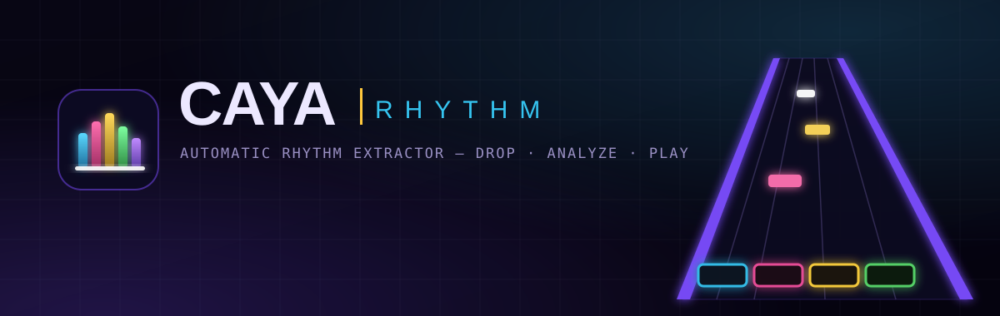
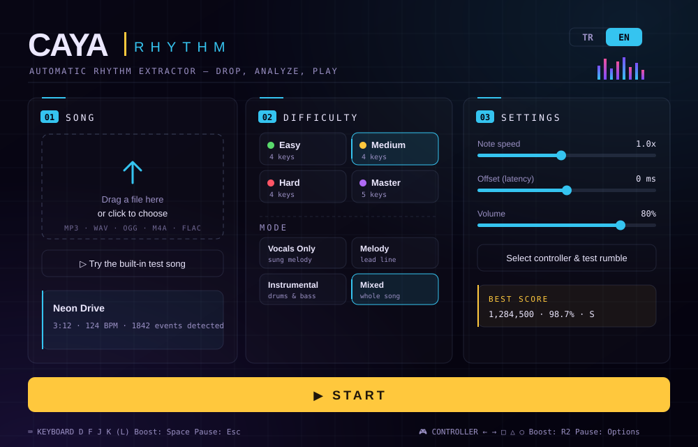
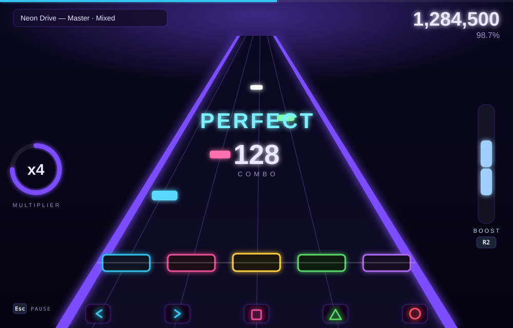

<div align="center">



# CaYa Rhythm

**Drop any song. It gets analyzed automatically. Play it on a neon 3D stage.**

A browser rhythm game that turns any audio file into playable note charts for vocals, lead, bass, drums or the full band. No manual mapping, no downloads. Built with vanilla JavaScript and Three.js.

### ▶ [Play it now on GitHub Pages](https://cayatur.github.io/CaYaRhythmGame/)

[](LICENSE)


[](https://github.com/CaYatur/CaYaRhythmGame/actions/workflows/pages.yml)

**English** · [Türkçe](README.tr.md)

</div>

---

## ✨ Features

### Gameplay
- **Five instrument parts.** **Vocals**, **Lead**, **Bass** (lanes follow the bass pitch), **Drums** (kick / snare / cymbals) and **Full band**. Each card shows its note count and an intensity rating.
- **Four difficulties.** Easy, Medium, Hard (4 lanes) and Master (5 lanes).
- **Part feedback.** When you miss, *your* part drops out of the mix (vocal band, bass shelf or drum shelves), and it comes back as you hit again.
- **Stage meter.** Hits fill it and misses drain it. Run it empty and you lose the stage (unless **No fail** is on). The crowd cheers or turns red with it.
- **Stars.** Up to 5 stars plus gold stars, shown live in the HUD and on the results screen.
- **Practice mode.** Pick any detected section and loop it at 50–100% speed.
- **Boost.** Clear the white note groups to charge it, then double your multiplier (up to 12×).
- **Results breakdown.** An early/late timing histogram with a latency suggestion, plus accuracy per song section.
- **Latency calibration.** Tap along to a click track and the game sets the offset for you.
- **Song library.** Analyzed songs are stored in your browser (IndexedDB) and reopen instantly, with no re-analysis.
- **Lefty flip**, adjustable note speed and volume.

### Audio analysis (all in-browser, ML-free)
- **Stereo center extraction** from inter-channel similarity, plus **REPET** background removal to isolate the vocal.
- **Sub-semitone pitch tracking** (harmonic salience, octave correction and Viterbi).
- **Human-voice gate.** A **formant** trace, **micro-pitch** motion (vibrato/jitter) and **harmonicity** reject synth leads and pads that only resemble vocals.
- **Drums.** SuperFlux onsets, with a kick **decay test** (rejects bass notes) and a snare **noisiness test** (rejects tonal plucks).
- **Tempo & beat grid** (Ellis DP), **bass pitch**, **song structure** (self-similarity novelty, labeled A/B/C… with an intensity rating) and an energy curve.

### Presentation
- **3D stage.** Truss arches with light strips, sweeping spotlights, a live-spectrum **LED wall**, pumping speaker stacks, and a crowd that bounces to the beat and reacts to your stage meter.
- **Note highway.** Beveled gem notes, a scrolling highway, beat and measure lines, bloom and particles. Lighting follows section intensity and the song's energy curve.
- **Keyboard & controller.** Full DualSense support over **WebHID** (reliable rumble, including Bluetooth), with a Gamepad-API fallback.
- **Bilingual UI.** English and Turkish, auto-detected and switchable on the fly.

## 🖼️ Preview

<div align="center">




</div>

## 🎮 Controls

| Action | Keyboard | DualSense |
| --- | --- | --- |
| Lanes (4) | `D` `F` `J` `K` | ◄ ► ▢ ◯ |
| Lanes (5 · Master) | `D` `F` `J` `K` `L` | ◄ ► ▢ △ ◯ |
| Boost | `Space` | `R2` |
| Pause | `Esc` | `Options` |

## 🚀 Getting started

**Easiest:** open **<https://cayatur.github.io/CaYaRhythmGame/>**. Nothing to install, and your audio never leaves your machine.

To run it locally (requires [Node.js](https://nodejs.org) 18+; there are no build tools):

```bash
git clone https://github.com/CaYatur/CaYaRhythmGame.git
cd CaYaRhythmGame
npm install                 # installs Three.js
npm run make-test-song      # generates the built-in test track (public/test-song.wav)
npm start                   # serves on http://localhost:3000
```

| Script | What it does |
| --- | --- |
| `npm test` | Scoring tests + a quick analysis benchmark |
| `npm run bench` | Full analysis benchmark (adds real songs from `public/testsongs/*.mp3` if present; needs `ffmpeg`) |
| `npm run build:pages` | Builds the static site into `_site/` (the same bundle that GitHub Pages serves) |

**Deployment:** every push to `main` runs `.github/workflows/pages.yml`. The workflow runs the tests, generates the test song, builds `_site/` and publishes it to GitHub Pages.

## 🧠 How it works

1. **Decode & resample** to 22.05 kHz stereo; the raw left/right channels go to a Web Worker.
2. **Analyze.** STFT on both channels, then a center mask, HPSS, REPET, pitch salience with Viterbi, voice features, drum and bass onsets, beat tracking and song structure.
3. **Build charts.** Events are snapped to the beat grid and spread across lanes per part and difficulty. Notes are tagged with their section.
4. **Play.** Three.js renders the stage, a Web Audio mixer handles part feedback and practice speed, and the scoring engine handles judgments, multiplier, boost, the stage meter and stars.

### Measured, not guessed

`tools/analysis-bench.mjs` runs the **real worker** headlessly against ground truth. The test material is a synthetic singer (glottal source, vowel formants, vibrato/jitter, consonants) mixed over synthetic beds and real songs, plus decoys that must **not** count as vocals: flat synth leads, vibrato synth leads and center pads. Every threshold in the worker was tuned on it.

| Metric (v1 → v2) | v1 | v2 |
| --- | --- | --- |
| Vocal recall under real mixes | 65% | **91%** |
| Vocal pitch accuracy (±1 semitone, real mixes) | 59% | **73%** |
| Vocal F1, synthetic | 0.53 | **0.84** |
| False "vocals" on synth leads / pads | 23.8 / min | **2.9 / min** |
| Kick / snare onset F1 | 61% / 28% | **71% / 41%** |

## 🏆 Scoring

- **Judgments:** Perfect (±50 ms) / Great (±105 ms) / Good (±150 ms) / Miss
- **Combo multiplier:** every 10 combo = +1×, up to **6×**; **Boost** doubles it
- **Hold notes:** keep pressed for continuous points plus a completion bonus
- **Stars:** relative to a perfect (no-boost) run; gold stars need a near-perfect score
- Best scores are saved per song + difficulty + part (localStorage)

## 📁 Project structure

```
public/
  index.html            UI shell + SVG icon library
  css/style.css         neon theme, menu, HUD, results
  js/
    main.js             app flow: library → stage → game / practice → results
    i18n.js             EN/TR strings
    audio/              analysis worker, bridge, game mixer (part feedback)
    game/               charts, scoring, input, DualSense HID, 3D engine, HUD, library
tools/                  benchmark, synthetic test signals, test song, Pages builder
.github/workflows/      GitHub Pages deployment
```

## 📄 License

[MIT](LICENSE) © 2026 [CaYaDev](https://cayadev.com)

---

<div align="center">

Made by **CaYaDev** · [cayadev.com](https://cayadev.com)

</div>
